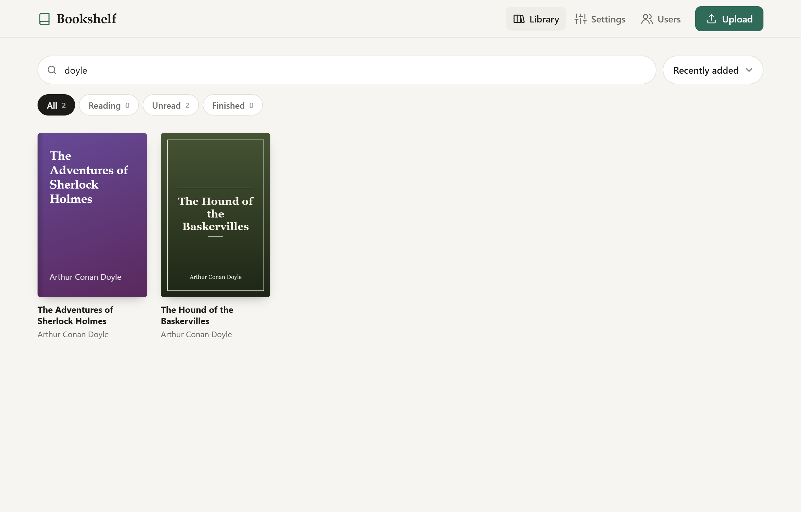

# Bookshelf

A lean, self-hosted e-book library with **KOReader progress sync** and an **OPDS catalog**.
Upload your books, read them on any KOReader device, and keep your reading position in sync.
Everything runs in one small Docker container with a single SQLite database.


<table>
  <tr>
    <td width="50%"></td>
    <td width="50%"></td>
  </tr>
  <tr>
    <td></td>
    <td></td>
  </tr>
</table>

<p align="center">
  
  &nbsp;&nbsp;
  
</p>

## Features

- **Simple uploads.** Drag and drop files anywhere on the page, or pick them. Duplicates are detected.
- **Automatic metadata.** Title, author, series, description and cover are read from EPUB, FB2, CBZ
  (ComicInfo) and PDF files. Other formats fall back to `Author - Title.ext` file names.
- **KOReader progress sync.** Built-in server that is compatible with KOReader's *Progress sync* plugin.
  Your library shows reading progress, a *Continue reading* row, and Reading/Unread/Finished filters.
- **OPDS catalog.** Browse, search and download your books directly from your e-reader.
- **Multiple users.** Every user has a private library. Admins manage accounts.
- **Clean, responsive UI.** Works on phones, tablets and desktops, in light and dark mode.
  No build step and no JavaScript framework.

Supported formats: EPUB, PDF, MOBI, AZW3, FB2, CBZ, CBR, DJVU, TXT, RTF, HTML, DOCX, CHM.

## Quick start (Docker)

```bash
git clone https://github.com/<you>/bookshelf.git
cd bookshelf
docker compose up -d
```

Open <http://localhost:8080> and create the administrator account.

Data (database, books, covers) is stored in the `bookshelf-data` volume, mounted at `/data`.
If you prefer a bind mount instead, make sure the directory is writable by UID 1000.

### Configuration

| Variable | Default | Description |
| --- | --- | --- |
| `BOOKSHELF_DATA_DIR` | `/data` | Where the database, books and covers are stored |
| `BOOKSHELF_PORT` | `8080` | HTTP port inside the container |
| `BOOKSHELF_ALLOW_REGISTRATION` | `false` | Allow KOReader to create accounts via *Register* |
| `BOOKSHELF_MAX_UPLOAD_MB` | `200` | Maximum size of a single upload |
| `BOOKSHELF_SESSION_DAYS` | `30` | How long a web login lasts |
| `BOOKSHELF_SECURE_COOKIES` | `false` | Set to `true` when served over HTTPS |

### Command line

```bash
docker exec -it bookshelf python -m bookshelf create-user alice --admin
docker exec -it bookshelf python -m bookshelf set-password alice
```

## Connecting KOReader

The *Settings* page in Bookshelf shows the exact addresses to use.

**Progress sync.** Open a book, then go to *Tools → Progress sync → Custom sync server* and enter
your Bookshelf address (for example `http://192.168.1.10:8080`). Then choose *Login* and use your
Bookshelf username and password. Keep the default document matching (*Binary*).

**OPDS catalog.** In the file browser, open *Search → OPDS catalog*, tap **+** and add
`http://<your-server>:8080/opds` with your Bookshelf username and password.

> Run Bookshelf behind a reverse proxy with HTTPS if you want to reach it from outside your
> home network. KOReader and OPDS clients send your credentials with every request.

## Development

Requires Python 3.12 or newer.

```bash
python -m venv .venv
.venv/bin/pip install -e ".[dev]"          # Windows: .venv\Scripts\pip
BOOKSHELF_DATA_DIR=./data-dev .venv/bin/python -m bookshelf serve --port 8765 --reload
.venv/bin/python scripts/dev_seed.py        # optional: demo books (login demo / demo1234)
.venv/bin/pytest
.venv/bin/ruff check . && .venv/bin/ruff format .
```

See [CLAUDE.md](CLAUDE.md) for the architecture and contribution conventions.

To regenerate the screenshots in `docs/screenshots/`, see `scripts/screenshots.py`
(uses Playwright with demo data from `scripts/dev_seed.py`).

## Tech stack

FastAPI · SQLAlchemy + Alembic · SQLite · Jinja2 · htmx · plain CSS and JavaScript

## Acknowledgements

- [KOReader](https://github.com/koreader/koreader) and its
  [sync server](https://github.com/koreader/koreader-sync-server), whose protocol Bookshelf implements.
- [htmx](https://htmx.org) (BSD Zero Clause License), bundled in `bookshelf/static/js/`.

## License

[MIT](LICENSE)
